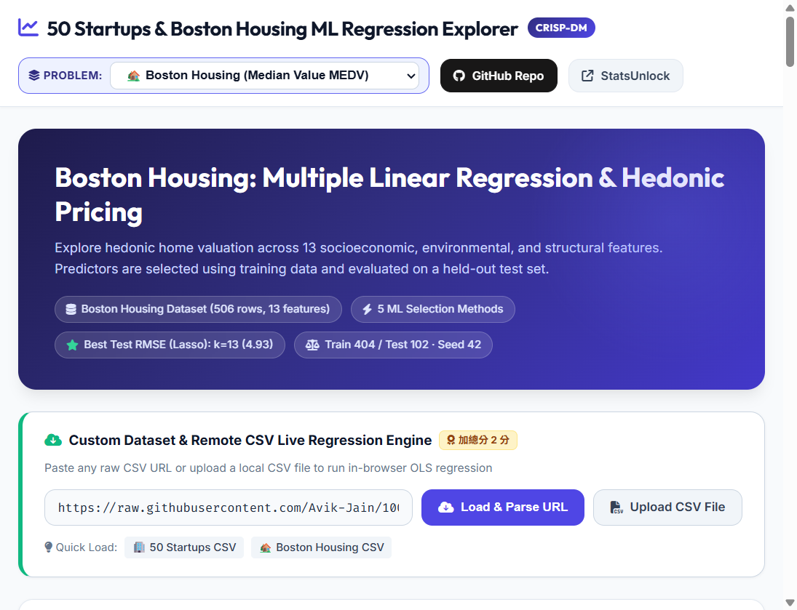

# 50 Startups & Boston Housing Regression Explorer

以多元線性迴歸比較 50 Startups 與 Boston Housing，並提供自訂 CSV 的瀏覽器內分析。

**Live demo:** [https://lannjiarong.github.io/kaggle-50-startup-and-boston-housing/](https://lannjiarong.github.io/kaggle-50-startup-and-boston-housing/)

**GitHub repository:** [Lannjiarong/kaggle-50-startup-and-boston-housing](https://github.com/Lannjiarong/kaggle-50-startup-and-boston-housing)

## Snapshot



## 功能

- 透過頁面下拉選單切換 50 Startups 與 Boston Housing。
- 比較 Lasso、Forward SFS、RFE、ElasticNet 與 Exhaustive Best Subset 五種特徵選擇方法。
- 檢視不同特徵數下的 Test RMSE、R²、係數、統計推論與測試集殘差。
- 貼上公開 CSV 網址或上傳本機 CSV，自行設定目標欄與預測特徵並執行 OLS。
- 使用互動式輸入測試模型預測；Boston 預測器提供 13 個特徵欄位。

## 訓練與評估

兩個內建資料集使用一致且可重現的流程：

- 以固定 `random_state=42` 隨機切分 80% 訓練集與 20% 測試集。
- Startup：50 筆資料，40 筆訓練、10 筆測試。
- Boston Housing：506 筆資料，404 筆訓練、102 筆測試。
- 特徵標準化及特徵排序只使用訓練資料，避免測試資料洩漏。
- OLS 係數、標準誤、t/F 統計量、p 值與信賴區間由訓練資料估計；RMSE、MAE、R² 與殘差診斷以保留的測試資料計算。
- Exhaustive 方法會搜尋所有特徵子集；Boston 的 13 個特徵共搜尋 8,191 個非空子集。

> 頁面標示的「最佳特徵數」是從多個特徵數的測試集 RMSE 中挑選，適合本作業的模型比較。若要產生無偏的最終泛化分數，應另保留驗證集或採用 nested cross-validation。

## 本機執行

以 Python 啟動靜態網站伺服器：

```powershell
python -m http.server 8000
```

開啟 <http://localhost:8000>。

重新訓練並產生網站使用的模型資料：

```powershell
python build_model_data.py
```

Boston 舊產生器入口 `generate_boston_data.py` 也會轉呼叫同一套流程。重訓需要 `numpy`、`pandas`、`scipy` 與 `scikit-learn`：

```powershell
python -m pip install numpy pandas scipy scikit-learn
```

## 主要檔案

- `index.html`：互動式回歸分析頁面。
- `50_Startups.csv`、`BostonHousing.csv`：原始資料集。
- `build_model_data.py`：固定切分、訓練五種特徵選擇流程並輸出模型資料。
- `startup_model_data.json`、`boston_model_data.json`：重新訓練後各資料集的模型結果。
- `model_data.js`：網頁直接載入的合併模型資料與訓練 metadata。
- `teacher_model_data.js`、`teacher_sample.html`：獨立保留的老師參考基準頁面與原始結果。
- `.github/workflows/pages.yml`：推送至 `main` 後自動部署 GitHub Pages。

## 資料來源

- [50 Startups](https://raw.githubusercontent.com/Avik-Jain/100-Days-Of-ML-Code/master/datasets/50_Startups.csv)
- [Boston Housing](https://raw.githubusercontent.com/selva86/datasets/master/BostonHousing.csv)
- [課程範例：Multiple Linear Regression](https://huanchen1107.github.io/AIoT-DIC2-MultipleLR/)
